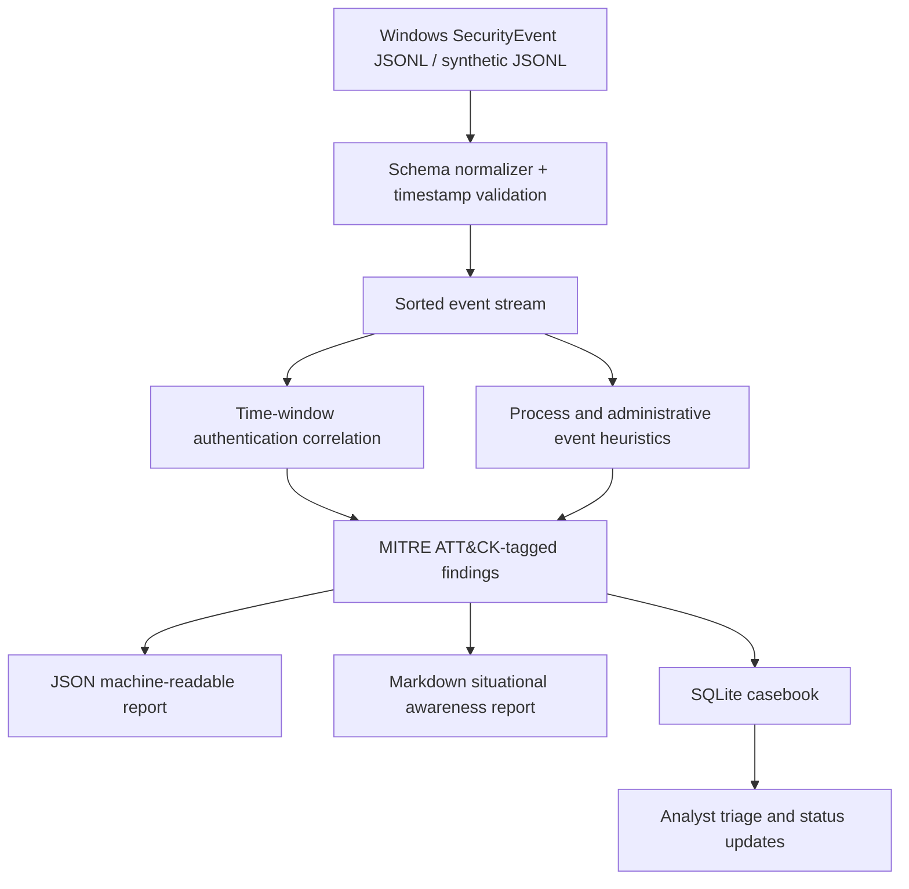

# Architecture and engineering decisions

## Threat model

- **Data origin:** JSONL file provided by the operator; this project does not scan networks or connect to production systems.
- **Trust boundary:** Event contents are untrusted. JSON lines are parsed into a documented subset of fields, validated and normalized to UTC. Malformed events fail with a line number rather than silently dropping evidence.
- **Analysis:** Deterministic rules correlate events; the tool never assumes a matching heuristic means confirmed malicious activity.
- **Case management:** SQLite persists case status and investigation notes. Rescans do not reset case dispositions. No alert is automatically blocked or remediated.
- **Outputs:** Stored reports can expose usernames, IP addresses, and command-line arguments. Use only synthetic or authorized, sanitized logs and restrict local file permissions as needed.

## Scope and limitations

- Operates on batches of Windows-like audit events; no live connector, endpoint collector, PCAP parser, malware sandbox, or full forensic acquisition.
- `SecurityEvent` normalization supports only a subset of field names. The event schema depends on the real ingestion connector.
- Repeated logon and spray detectors produce one alert per (IP,user) or IP group per batch, not a production-grade streaming incident window.
- Group modification evidence does not resolve the affected member; the original full event is necessary for incident investigation.
- The encoded PowerShell signature is intentionally simple and has false positives and false negatives; no malicious payload is executed or decoded.
- Case IDs are stable for identical inputs and their row identifiers but may change as the input batch/window expands. Production alert deduplication requires dedicated event identity and ingestion watermark design.
- For scaled environments: use durable event streams, normalized schemas, backpressure, alert deduplication, rate-limited enrichment, role-based case controls, and unit/coverage monitoring.
